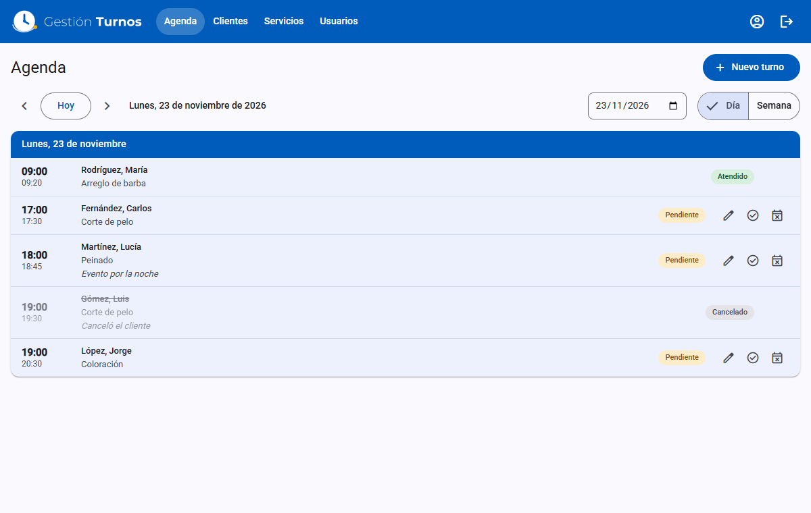

# Sistema de gestión de turnos

Práctica de Laboratorio – Tecnicatura en Programación de Computadoras (560)

Aplicación web para que un negocio de atención al público administre **clientes, servicios y la agenda de turnos**, evitando superposiciones de horarios.

- **Alumno:** Tomás Bolotnicoff
- **Docente:** Mg. Ing. Guillermo Ramiro Maquieira



## Qué hace

- **Agenda** por día y por semana: alta, edición, atención y cancelación de turnos, con control automático de superposición de horarios.
- **ABM de clientes, servicios y usuarios**, con baja lógica (no se borra nada) y listados paginados desde el servidor.
- **Login con roles:** el *Administrador* gestiona todo, incluidos los usuarios; el *Operador* trabaja con agenda, clientes y servicios.

## Stack

| Capa | Tecnología |
|---|---|
| Frontend | Angular 22, Angular Material |
| Backend | ASP.NET Core (.NET 10), Entity Framework Core, JWT |
| Base de datos | SQL Server (con proyecto de base de datos `.sqlproj`) |
| Pruebas | xUnit, Vitest, Puppeteer |

## Puesta en marcha rápida

Requisitos: .NET SDK 10, Node.js 22 o superior, SQL Server (sirve LocalDB) y `sqlcmd`. El paso a paso completo está en la [guía de instalación y uso](docs/guia-de-instalacion-y-uso.md).

```powershell
# 1. Base de datos (con datos de ejemplo)
sqlcmd -S "(localdb)\MSSQLLocalDB" -E -Q "CREATE DATABASE GestionTurnos"
sqlcmd -S "(localdb)\MSSQLLocalDB" -E -d GestionTurnos -b -i docs\diseno\base-de-datos.sql
sqlcmd -S "(localdb)\MSSQLLocalDB" -E -d GestionTurnos -b -f 65001 -i database\datos-de-ejemplo.sql

# 2. API (en una terminal)
$env:ConnectionStrings__Default = 'Server=(localdb)\MSSQLLocalDB;Database=GestionTurnos;Trusted_Connection=True;TrustServerCertificate=True'
$env:ASPNETCORE_ENVIRONMENT = 'Development'
dotnet run --project backend/GestionTurnos.Api --urls http://localhost:5080

# 3. Frontend (en otra terminal)
cd frontend
npm install
npm start
```

Abrir **http://localhost:4200** e ingresar con:

| Usuario | Contraseña | Rol |
|---|---|---|
| `admin` | `Admin1234!` | Administrador |
| `operador` | `Operador1234!` | Operador |

Son credenciales de ejemplo, solo para probar.

## Estructura del repositorio

| Carpeta | Contenido |
|---|---|
| `backend/` | API REST en .NET 10 (`GestionTurnos.Api`) y sus pruebas (`GestionTurnos.Tests`) |
| `frontend/` | Aplicación Angular |
| `database/` | Proyecto de base de datos de SQL Server y datos de ejemplo |
| `docs/` | Documentación (ver abajo) |

Se trabaja con el patrón **Modelo–Vista–Controlador** en el backend y en el frontend.

## Documentación

| Documento | Contenido |
|---|---|
| [Guía de instalación y uso](docs/guia-de-instalacion-y-uso.md) | Cómo instalar, configurar y usar el sistema, con capturas |
| [Documentación funcional](docs/documentacion-funcional.md) | Requerimientos, reglas de negocio, permisos, API y trazabilidad con las pruebas |
| [Modelado UML](docs/diseno/modelado-uml.md) | Casos de uso, clases, entidad-relación y secuencias |
| [Diseño de la base de datos](docs/diseno/base-de-datos.md) | Diccionario de datos, índices y regla de superposición |
| [Documentación de pruebas](docs/pruebas/documentacion-de-pruebas.md) | Estrategia, cómo ejecutar cada nivel y resultados |
| [Catálogo de pruebas](docs/pruebas/catalogo-de-pruebas.md) | Listado de todas las pruebas automáticas |
| [Resultados de punta a punta](docs/pruebas/resultados-e2e.md) | Resultado de los 56 casos en un navegador real |
| [Bitácora](docs/bitacora.md) | Etapas del trabajo, decisiones técnicas, problemas y herramientas |

## Pruebas

| Nivel | Pruebas | Resultado | Cobertura de líneas |
|---|---|---|---|
| Backend (xUnit) | 163 | ✅ todas correctas | 95,7 % |
| Frontend (Vitest) | 262 | ✅ todas correctas | 98,73 % |
| Punta a punta (navegador real) | 56 | ✅ todas correctas | — |

```powershell
dotnet test backend/GestionTurnos.Tests        # con la API detenida
cd frontend; npx ng test --no-watch            # frontend
cd docs/pruebas/e2e; npm install; npm run e2e  # punta a punta (usar una base de pruebas)
```

Más detalle en la [documentación de pruebas](docs/pruebas/documentacion-de-pruebas.md).
