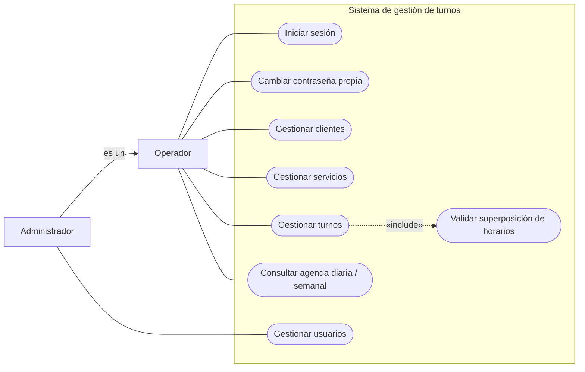
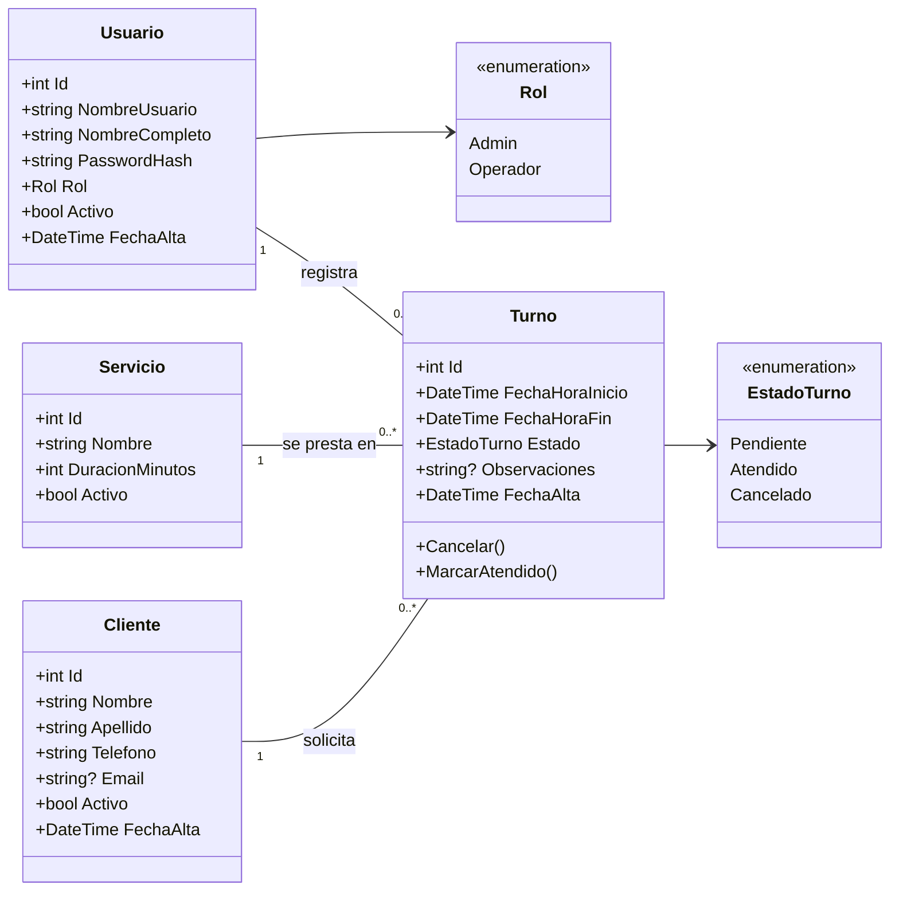
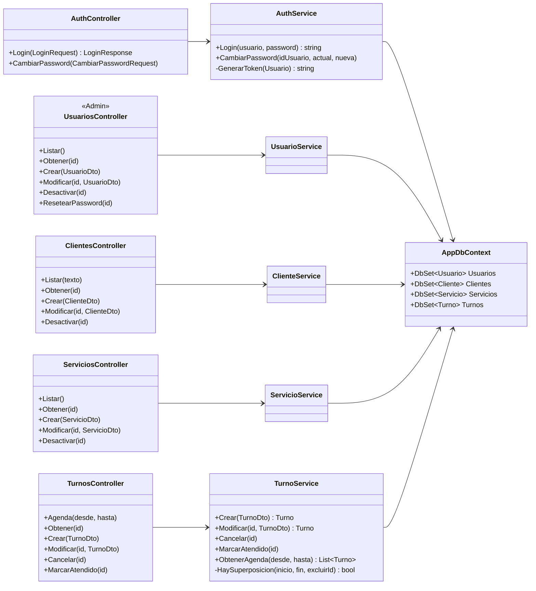
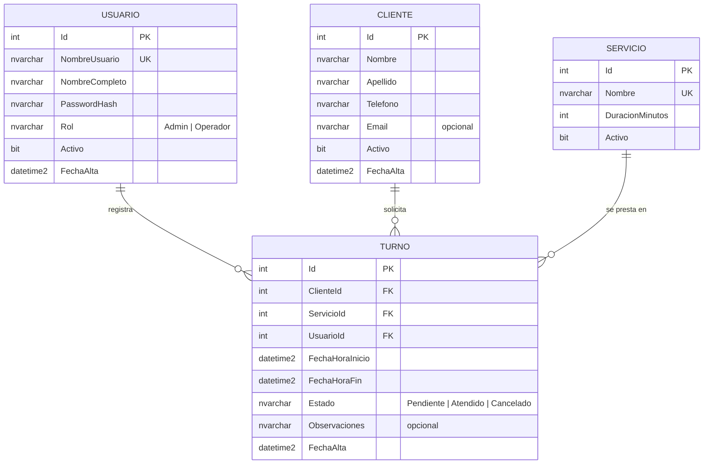
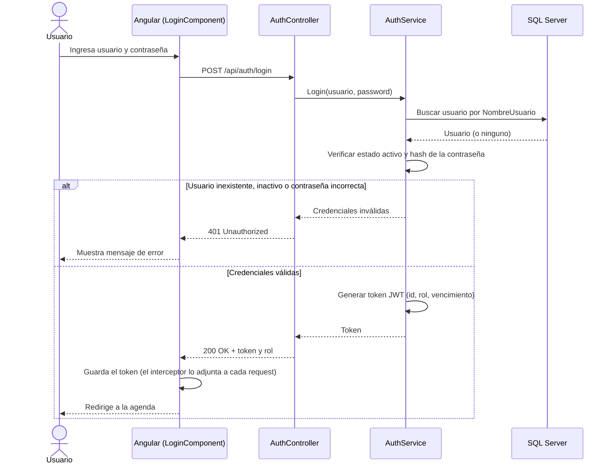
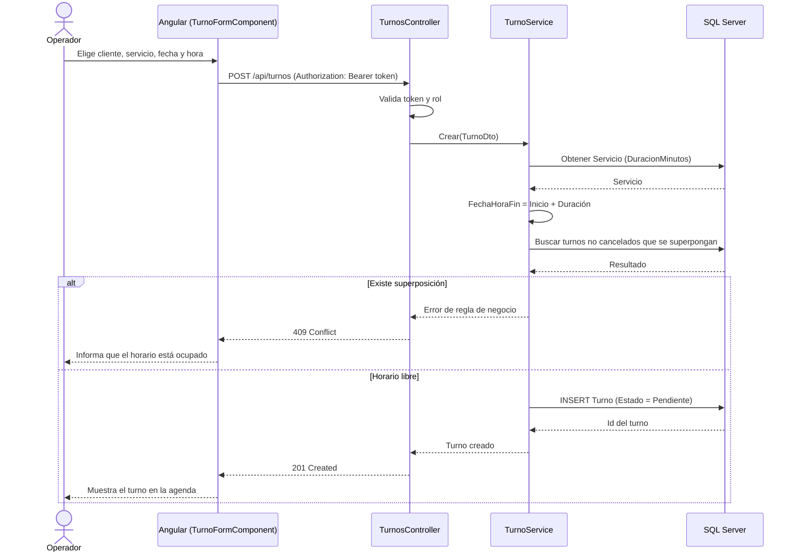

# Modelado UML – Sistema de gestión de turnos

Práctica de Laboratorio – Tecnicatura en Programación de Computadoras (560)
Alumno: Tomás Bolotnicoff · Docente: Mg. Ing. Guillermo Ramiro Maquieira

Diagramas en sintaxis [Mermaid](https://mermaid.js.org/). Se visualizan directamente en VS Code (extensión *Markdown Preview Mermaid Support*) y en GitHub. Las imágenes exportadas están en [`img/`](img/).

Contenido:

1. Diagrama de casos de uso
2. Diagrama de clases del dominio
3. Diagrama de clases de la arquitectura (backend)
4. Diagrama entidad-relación
5. Diagrama de secuencia: iniciar sesión
6. Diagrama de secuencia: alta de turno

---

## 1. Diagrama de casos de uso

Actores: **Administrador** y **Operador**. El Administrador hereda todo lo que puede hacer el Operador y además gestiona usuarios.

| Caso de uso | Descripción | Actor |
|---|---|---|
| Iniciar sesión | Valida usuario y contraseña y entrega un token JWT. Es precondición de todos los demás casos de uso, por eso no se dibuja una relación hacia cada uno. | Operador, Administrador |
| Cambiar contraseña propia | El usuario autenticado modifica su contraseña. | Operador, Administrador |
| Gestionar clientes | Alta, modificación, consulta y baja lógica de clientes. | Operador, Administrador |
| Gestionar servicios | Alta, modificación, consulta y baja lógica de servicios (nombre y duración en minutos). | Operador, Administrador |
| Gestionar turnos | Alta, modificación, cancelación y marcado como atendido de turnos. | Operador, Administrador |
| Validar superposición de horarios | Rechaza un turno que se superponga con otro vigente. Se ejecuta siempre al crear o modificar un turno. | (incluido) |
| Consultar agenda diaria / semanal | Muestra los turnos de un día o de una semana. | Operador, Administrador |
| Gestionar usuarios | Alta, modificación, baja lógica, asignación de rol y reseteo de contraseña. | Administrador |

---

## 2. Diagrama de clases del dominio

Notas:

- `FechaHoraFin` se calcula al guardar: `FechaHoraInicio + Servicio.DuracionMinutos`.
- `Activo = false` representa la baja lógica de usuarios, clientes y servicios; así los turnos históricos conservan sus referencias.
- Un turno `Cancelado` no bloquea el horario; `Atendido` y `Pendiente` sí.

---

## 3. Diagrama de clases de la arquitectura (backend)

Capas: **Controllers** (HTTP, autorización por rol) → **Services** (reglas de negocio) → **AppDbContext** (EF Core, acceso a SQL Server).

Los servicios se registran por inyección de dependencias. La regla de superposición vive únicamente en `TurnoService` y es lo que se cubre con pruebas unitarias (xUnit).

---

## 4. Diagrama entidad-relación

El detalle de tipos, restricciones e índices está en [base-de-datos.md](base-de-datos.md).

---

## 5. Diagrama de secuencia: iniciar sesión

---

## 6. Diagrama de secuencia: alta de turno

