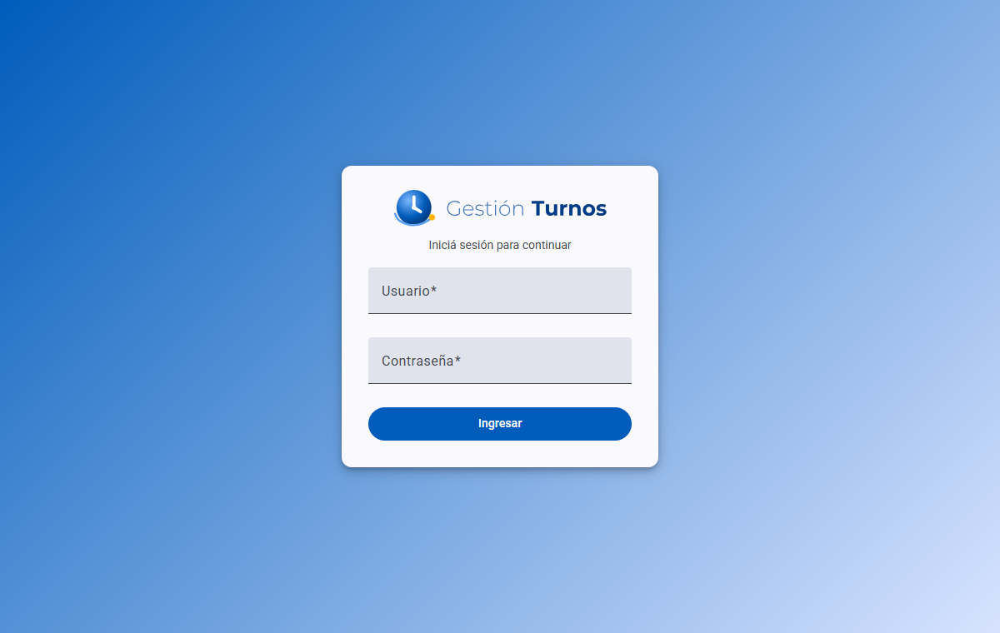
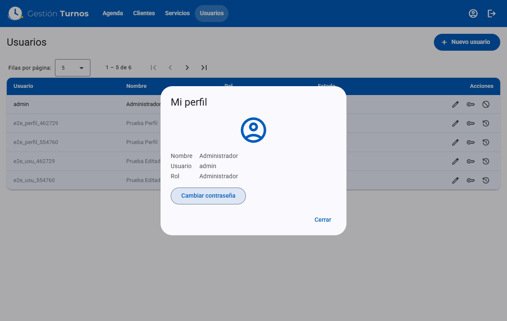
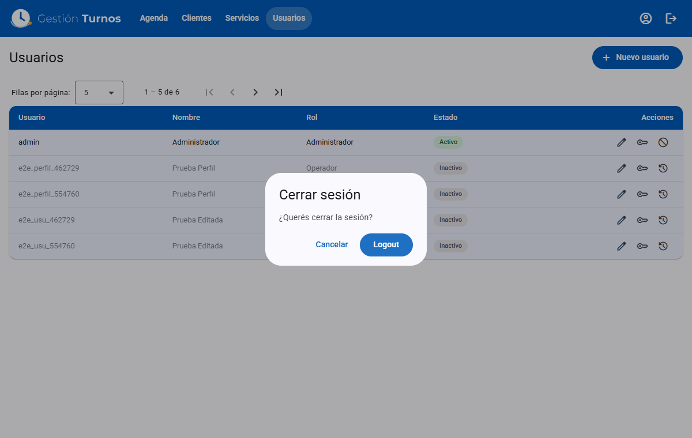
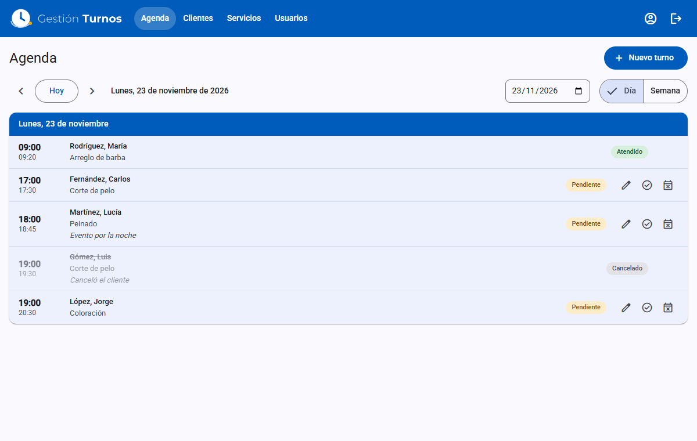
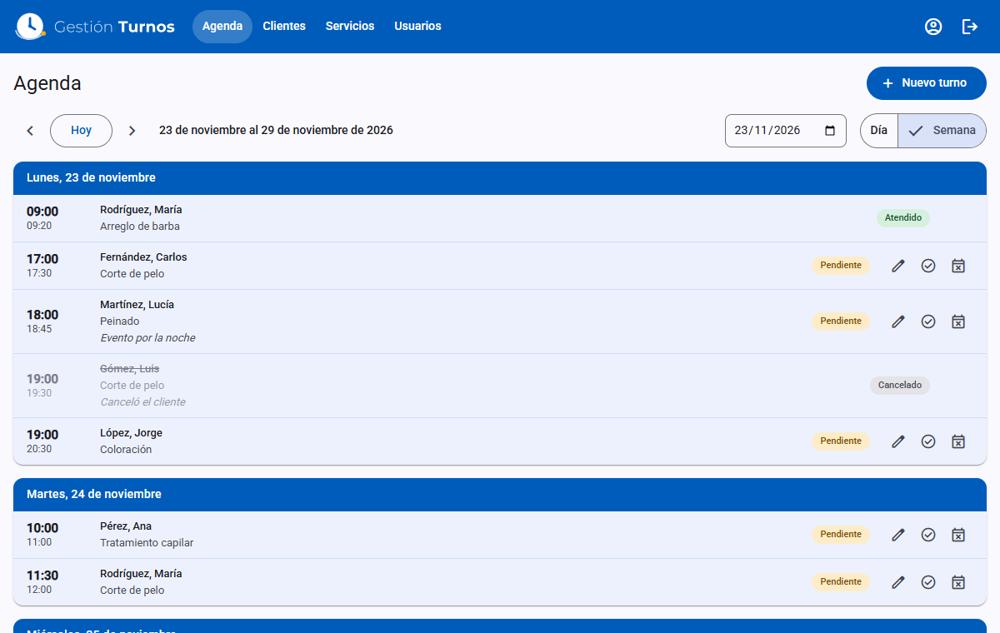
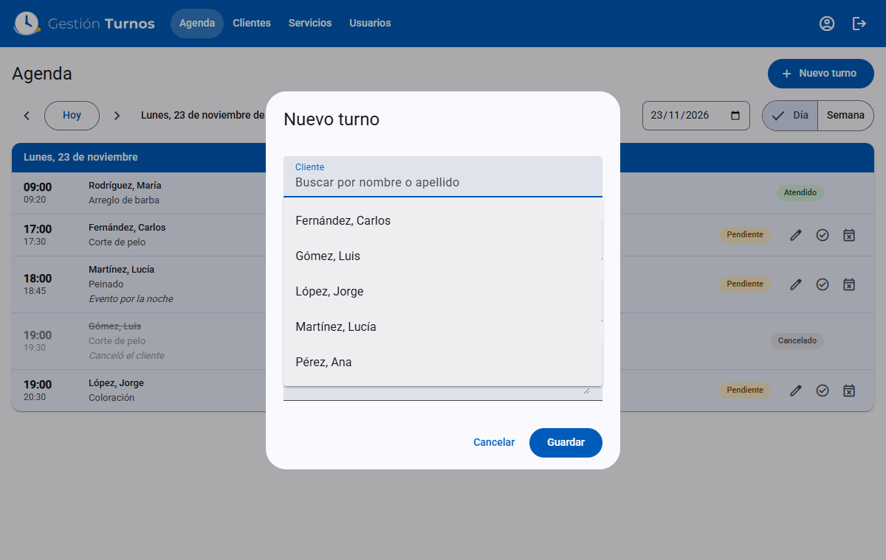
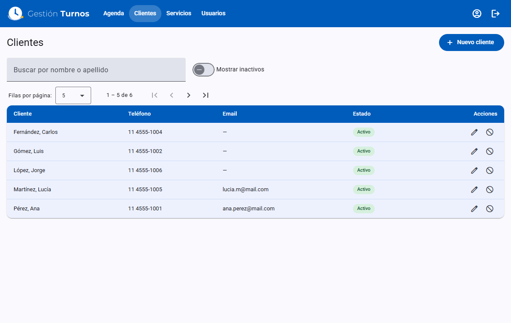
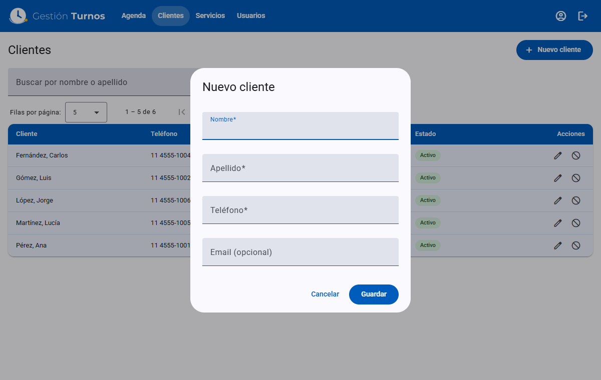
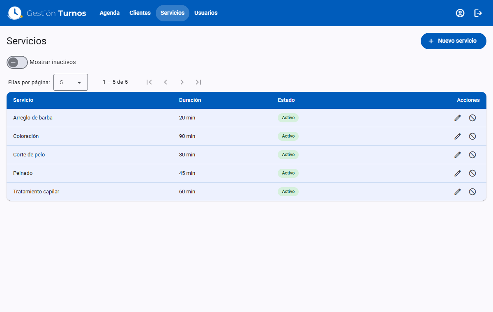

# Guía de instalación y uso – Sistema de gestión de turnos

Esta guía explica cómo dejar el sistema funcionando en una computadora con Windows y cómo usarlo. Qué hace cada función y sus reglas está en la [documentación funcional](documentacion-funcional.md).

## 1. Requisitos

| Programa | Versión | Para qué |
|---|---|---|
| [.NET SDK](https://dotnet.microsoft.com/download) | 10 | Compilar y ejecutar la API |
| [Node.js](https://nodejs.org) | 22 o superior (incluye npm) | Compilar y ejecutar el frontend |
| SQL Server | 2019 o superior (sirve Express o LocalDB) | Base de datos |
| Herramientas de línea de comandos de SQL Server (`sqlcmd`) | cualquiera | Crear la base y cargar datos |
| [Git](https://git-scm.com) | cualquiera | Descargar el código |
| Google Chrome | opcional | Solo para las pruebas de punta a punta |

Para comprobar lo instalado:

```powershell
dotnet --version     # 10.x
node --version       # v22 o superior
sqlcmd -?            # muestra la ayuda
```

## 2. Instalación

### 2.1 Descargar el código

```powershell
git clone https://github.com/tomas-maker2/sistema-gestion-turnos.git
cd sistema-gestion-turnos
```

### 2.2 Crear la base de datos

Los comandos siguientes usan LocalDB (`(localdb)\MSSQLLocalDB`), que viene con Visual Studio. Si se usa otra instancia de SQL Server, reemplazar el valor de `-S` por el nombre del servidor (por ejemplo `.\SQLEXPRESS` o `localhost`).

```powershell
# 1. Crear la base vacía
sqlcmd -S "(localdb)\MSSQLLocalDB" -E -Q "CREATE DATABASE GestionTurnos"

# 2. Crear las cuatro tablas
sqlcmd -S "(localdb)\MSSQLLocalDB" -E -d GestionTurnos -b -i docs\diseno\base-de-datos.sql
```

> **Alternativa con el proyecto de base de datos.** La estructura de la base también está como proyecto de SQL Server en `database/GestionTurnos.Database` (un archivo por tabla), pensado para compararla con una base real desde Visual Studio (*Schema Compare*). Se puede publicar con `dotnet build database/GestionTurnos.Database` y `sqlpackage /Action:Publish`, o con *Publish* desde Visual Studio, en lugar del paso 2.

### 2.3 Cargar datos de ejemplo (opcional, recomendado para probar)

```powershell
sqlcmd -S "(localdb)\MSSQLLocalDB" -E -d GestionTurnos -b -f 65001 -i database\datos-de-ejemplo.sql
```

Carga 2 usuarios, 6 clientes, 5 servicios y 10 turnos de ayer, hoy, mañana y pasado mañana. Si la tabla de usuarios ya tiene datos, no hace nada.

| Usuario | Contraseña | Rol |
|---|---|---|
| `admin` | `Admin1234!` | Administrador |
| `operador` | `Operador1234!` | Operador |

> **Sin datos de ejemplo:** si se omite este paso, al primer arranque de la API (en modo `Development`, paso 2.5) se crea solo el administrador `admin` / `Admin1234!`, tomado de la configuración `SembradoAdmin`.
>
> Estas contraseñas son de ejemplo. Para un uso real hay que cambiarlas (ver [Configuración](#5-configuración)).

### 2.4 Indicar a la API dónde está la base

La cadena de conexión está en `backend/GestionTurnos.Api/appsettings.json`:

```json
"ConnectionStrings": {
  "Default": "Server=WKS137;Database=GestionTurnos;Integrated Security=True;TrustServerCertificate=True"
}
```

**Hay que cambiar `WKS137` por el servidor propio** (por ejemplo `(localdb)\MSSQLLocalDB`). Para no tocar el archivo versionado, también se puede definir la variable de entorno antes de iniciar la API:

```powershell
$env:ConnectionStrings__Default = 'Server=(localdb)\MSSQLLocalDB;Database=GestionTurnos;Trusted_Connection=True;TrustServerCertificate=True'
```

### 2.5 Iniciar la API

En una terminal, desde la raíz del repositorio:

```powershell
$env:ASPNETCORE_ENVIRONMENT = 'Development'
dotnet run --project backend/GestionTurnos.Api --urls http://localhost:5080
```

Queda escuchando en `http://localhost:5080`. Con `Development` se usa la clave de firma de sesiones y el administrador inicial de `appsettings.Development.json`. La terminal debe quedar abierta.

### 2.6 Iniciar el frontend

En otra terminal:

```powershell
cd frontend
npm install        # solo la primera vez
npm start
```

Cuando termina de compilar, la aplicación queda en **http://localhost:4200**.

> El frontend espera la API en `http://localhost:5080` y la API acepta pedidos desde `http://localhost:4200`. Si se cambia alguno de los dos puertos, hay que cambiar `frontend/src/app/core/api-config.ts` y la política de CORS en `backend/GestionTurnos.Api/Program.cs`.

## 3. Primer ingreso

1. Abrir **http://localhost:4200** en el navegador.
2. Ingresar con `admin` / `Admin1234!`.
3. Se abre la agenda del día.



## 4. Uso del sistema

### 4.1 Encabezado y menú

En el encabezado están el logo, el menú (**Agenda**, **Clientes**, **Servicios** y, solo para el administrador, **Usuarios**) y, a la derecha:

- **Ícono de usuario:** abre *Mi perfil*, con el nombre, el usuario y el rol, y la opción de cambiar la contraseña.
- **Ícono de salida:** cierra la sesión (pide confirmación).





### 4.2 Agenda

La agenda muestra los turnos de un día, ordenados por hora. Cada turno indica hora de inicio y de fin, cliente, servicio, observaciones y estado.



| Quiero... | Cómo |
|---|---|
| Ver otro día | Flechas **‹** y **›**, o elegir una fecha en el selector |
| Volver a hoy | Botón **Hoy** |
| Ver la semana | Botón **Semana** (y **Día** para volver) |
| Agendar un turno | Botón **Nuevo turno** |
| Modificar un turno | Ícono del lápiz |
| Marcar un turno como atendido | Ícono de la tilde (pide confirmación) |
| Cancelar un turno | Ícono del calendario tachado (pide confirmación) |

Los turnos **atendidos** y **cancelados** no tienen botones: quedan como registro. Un turno cancelado se ve atenuado y libera su horario.



#### Agendar un turno

1. Pulsar **Nuevo turno**.
2. En **Cliente**, escribir parte del nombre o apellido y **elegir** al cliente de la lista (no alcanza con escribirlo).
3. Elegir el **Servicio**. Debajo de la fecha aparece a qué hora termina ("Termina a las 09:30").
4. Ajustar **Fecha y hora** y, si hace falta, **Observaciones**.
5. Pulsar **Guardar**.



Si el horario se superpone con otro turno o ya pasó, el sistema lo informa dentro del mismo formulario, sin perder lo cargado, para corregir la hora. Un turno que empieza justo cuando otro termina es válido.

### 4.3 Clientes



- **Buscar:** escribir parte del nombre o apellido; el listado se filtra solo.
- **Mostrar inactivos:** incluye a los clientes dados de baja.
- **Nuevo cliente:** nombre, apellido y teléfono son obligatorios; el email es opcional.
- **Editar** (lápiz) y **Desactivar** (círculo tachado, con confirmación). Un cliente desactivado se puede **reactivar** desde *Mostrar inactivos*. Nunca se borra.



### 4.4 Servicios



Funciona igual que clientes. Cada servicio tiene un **nombre único** y una **duración en minutos** (entre 5 y 480), que determina cuánto dura cada turno de ese servicio.

### 4.5 Usuarios (solo administrador)


- **Nuevo usuario:** usuario, nombre completo, contraseña inicial (mínimo 8 caracteres) y rol (Administrador u Operador).
- **Editar:** cambia el nombre y el rol. El nombre de usuario no se modifica.
- **Restablecer contraseña:** define una contraseña nueva para otra persona.
- **Desactivar / Reactivar:** un usuario desactivado no puede ingresar. Un administrador no puede desactivarse a sí mismo y siempre debe quedar al menos un administrador activo.

### 4.6 Paginado de los listados

Las tres grillas (usuarios, clientes y servicios) se paginan desde el servidor. Arriba a la izquierda se elige cuántas **filas por página** (5, 10, 30, 50 o 100; por defecto 5) y se navega con las flechas de primera, anterior, siguiente y última página. El contador muestra, por ejemplo, "1 – 5 de 6".

## 5. Configuración

| Qué | Dónde | Notas |
|---|---|---|
| Cadena de conexión | `appsettings.json` → `ConnectionStrings:Default`, o variable `ConnectionStrings__Default` | Obligatoria para que la API se conecte |
| Clave de firma de sesiones | `Jwt:Key` (variable `Jwt__Key`) | En `appsettings.Development.json` hay una clave solo para desarrollo. **En un uso real hay que definir una propia** de 32 caracteres o más |
| Duración de la sesión | `appsettings.json` → `Jwt:HorasValidez` | 8 horas por defecto |
| Administrador inicial | `SembradoAdmin:Usuario` y `SembradoAdmin:Password` | Solo se usa si la tabla de usuarios está vacía |
| Puerto de la API | `--urls` al ejecutar | Si cambia, actualizar `frontend/src/app/core/api-config.ts` |

## 6. Problemas frecuentes

| Síntoma | Causa probable | Qué hacer |
|---|---|---|
| La API no arranca: "Cannot open database" o error de conexión | La cadena de conexión apunta a un servidor que no existe o la base no está creada | Revisar el paso 2.2 y 2.4 |
| El login responde "Usuario o contraseña incorrectos" con las credenciales de esta guía | La base no tiene los datos de ejemplo y tampoco se creó el administrador inicial | Cargar los datos de ejemplo (paso 2.3), o iniciar la API en modo `Development` con la tabla de usuarios vacía |
| El login falla con un error del servidor (500) | La API se inició sin la clave de firma de sesiones (`Jwt:Key`), que solo está en `appsettings.Development.json` | Iniciar la API con `ASPNETCORE_ENVIRONMENT=Development` (paso 2.5) o definir `Jwt__Key` |
| El navegador muestra errores de CORS o "Failed to fetch" | La API no está levantada, o está en otro puerto | Verificar que la API escuche en `http://localhost:5080` |
| `dotnet test` falla con "file is being used by another process" | La API está corriendo y bloquea los archivos | Detener la API antes de ejecutar las pruebas |
| La agenda aparece vacía | No hay turnos para ese día | Es normal. Usar **Nuevo turno**, o cambiar de día con las flechas |
| `ng` o `npm start` no se reconocen | Falta ejecutar `npm install` en `frontend` | Ejecutar `npm install` |

## 7. Detener y limpiar

- Detener la API y el frontend con `Ctrl + C` en cada terminal.
- Para empezar de cero con la base: `sqlcmd -S "(localdb)\MSSQLLocalDB" -E -Q "DROP DATABASE GestionTurnos"` y repetir desde el paso 2.2.
